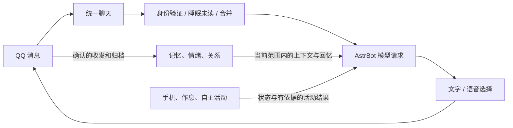

# 小鲸鱼 🐋

小鲸鱼是一个基于 AstrBot、QQ 接入端和安卓备用机的个人陪伴项目。它尝试把聊天、可追溯记忆、作息和经授权的自主活动连接起来，让回复与行动都有上下文和边界。

本仓库展示经过脱敏整理的源码，**不是一键安装包，也不包含运行中的实例或私人数据**。本次源码同步至 2026-11-07 的本地维护版本；管理中心目录保留此前公开版本，不能代表当前部署的网页。

想了解代码怎样协作，请读 **[模块实现与协作详解](docs/IMPLEMENTATION.md)**：从一条 QQ 消息出发，说明聊天、记忆、情绪、语音、作息和手机活动的调用链、数据边界、失败处理及源码入口。

## 现在有哪些能力

- **统一 QQ 聊天：** 好友申请与身份核验、按联系人合并消息、自然收尾、主动联系、睡眠未读与可选语音，由 `astrbot_plugin_companion_chat` 协调。不同功能保留各自开关、权限和额度；休息或睡眠期间按既有规则处理未读。
- **分层记忆与场景：** 记忆按联系人、公开资料与获准群等范围区分，保留原话来源、版本与有效性。可检索事实、计划、经历、原文和场景背景；遗忘、更正和失效会影响后续召回。检索未命中不代表事情没有发生。
- **情绪、关系与缓慢成长：** 整体心情、对每位联系人的态度、双方确认的关系及跨日成长分别处理；情绪来源和私人关系按范围保护。系统状态是程序中的建模和表达依据，不等于可以证明人的主观体验。
- **可选语义检索：** 在现有记忆库之外维护按范围隔离的可读投影和语义候选，结合全文检索进行排序。需要单独启用、配置嵌入服务及预算；不启用时不能假定语义功能可用，也不保证召回准确。
- **备用机与自主社交：** 手机插件提供受授权和配额约束的观察、应用操作、阅读、图片、作息及日记能力。QQ 空间与个人资料的新操作通过外部 QQ空间Ultra、QQProfile 插件及兼容层执行；是否实际完成以操作回执为准。
- **多模态与语音：** 统一聊天可接入 Breeze 语音回复，另有百炼语音识别适配器和预制清唱片段播放入口。语音、识图和视频理解依赖独立插件、服务、素材及配置，源码存在并不表示每项能力都已启用或可复现。

## 功能如何协作



这张图概括职责，不意味着每次聊天都会调用所有模块。消息先经过身份与作息判断；允许处理时，模型获取预算内的相关记忆、整体心情和当前联系人的适用关系信息。需要时可回忆、使用获授权工具或选择语音。生成、调用、准备发送、接入端回执是不同阶段，不能把意图当作已经执行。

### 聊天、消息约定与真实回执

统一聊天把好友申请、私聊接入、消息合并、主动联系与语音协调在一起。好友按真实联系人隔离；休息期间适用消息进入持久未读，醒后按原发送者恢复。引用和转发材料与联系人本人陈述区分，普通好友不会因此获得管理员的手机或隐私工具。

代码还支持有原话依据的私聊问候、提醒等消息约定：记录触发条件、发送状态和回执；醒来触发以角色真实醒来为准。约定仅覆盖约定的消息，不自动授权手机操作、公开发布或联系第三人。处理失败和结果不确定有独立记录，不能声称已完成或盲目重复发送。

### 记忆、检索与上下文连续性

原始观察和整理后的事实、计划、经历保存在 SQLite，以联系人和来源编号区分；更正保留版本，失效、冲突和明确遗忘参与后续过滤。场景卡将同一事项的背景、当前说法、限制、未决计划和时间线组织为可核对的视图。工具可以先查目录，再分页读取来源；没有命中不代表从未发生。

检索结合全文索引与可选语义候选；可选的查询规划处理日期或比较问题，弱匹配时不应把表面词重合当成已经回答。语义索引、可读笔记投影需要单独配置，仍须核对原始范围、有效性和证据。上下文和工具返回设有字节与调用预算；备份恢复只能写入新的隔离目录。

### 情绪、态度和关系

角色使用一份随互动变化与时间衰减的整体心情；对具体联系人的熟悉、信任、亲近等较慢变化另按人保存，相关事件与来源受隔离保护。普通纠错、离线或不回复不自动视为攻击；一人的道歉不会自动修复与另一人的事件。

关系事实与情绪、态度分开：重要关系需要双方分别同意，家人关系还需要管理员核验；昵称、分数或单方说法不能自动建立关系或改变权限。成长可参考有依据的跨日互动，也有基于自选实践和可验证回执的路径；不凭模型自述或一次情绪制造经历。这些都是程序机制，不证明主观体验。

### 语音、图片及其他媒体

收到语音时，可选的百炼语音识别适配器将音频交给配置的识别服务；图片、视频等依赖已安装的媒体理解组件。聊天插件可记录实际媒体处理的来源和结果边界，不把附件存在或模型猜测当成已经看见、听见全部内容。

回复时，模型结合语境和对方明确的媒介偏好选择文字或语音；Breeze 接收说话正文与经过检查的表演方向。合成结果经过音频处理、发送前权限与睡眠检查，并以回执区分准备、发送和接受。仓库还包含从已准备的有限曲目中选择清唱片段的代码，实际音频和音色不随仓库提供；这不是任意歌曲实时演唱服务。

### 自主活动、日记与 QQ 社交

手机插件将作息、授权应用范围、观察、操作、阅读和活动回执连接起来；角色睡眠门控与设备网络连接维护分开。空闲思考可以选择回忆、整理、阅读或暂不行动，但受权限、预算和实际工具结果约束；自选成长候选要有可核验的实践来源。

公开与私密日记分别管理。QQ 空间和资料的现行操作通过外部插件及兼容层进行，后台调度提供考虑机会而非保证发布；是否成功由对应平台回执和可见性决定。公开表达不自动取得私人聊天或私密日记的发布授权。

## 代码目录

| 目录 | 用途与状态 |
| --- | --- |
| [companion_chat](astrbot-plugins/astrbot_plugin_companion_chat/) | 统一聊天入口，包含 `active/`、`batch/`、`friends/`、`breeze/` 四个内部组件 |
| [companion_memory](astrbot-plugins/astrbot_plugin_companion_memory/) | 联系人隔离、来源依据、场景、成长与可选语义检索 |
| [companion_phone](astrbot-plugins/astrbot_plugin_companion_phone/) | 作息、手机活动、日记及外部社交插件兼容 |
| [companion_asr](astrbot-plugins/astrbot_plugin_companion_asr/) | 可选的百炼语音识别适配 |
| `companion_active`、`companion_batch`、`companion_friends`、`companion_breeze` | 保留的旧独立插件源码；与统一聊天的内部组件不是可以同时重复启用的另一套调度 |
| `companion_bailian_sing` | 隔离试听实验源码；不代表当前生产能力 |
| [management-center](management-center/) | 此前公开的管理中心快照，**不包含本次管理中心更新** |
| [tests](tests/)、[tools](tools/) | 隔离测试与白名单脱敏导出工具 |

当前导出源码的主要版本标识为聊天 v1.13.3、记忆 v1.19.6、手机 v1.21.2、语音识别 v0.1.1。版本号描述仓库源码，不是对任何服务器当前状态或第三方服务可用性的保证。原仓库中部分旧空间模块和测试为历史兼容材料；现行手机社交执行链使用外部插件，不能把历史代码当作当前配置。

## 部署与安全边界

1. 自行准备兼容的 AstrBot、QQ 接入端、Python 环境和模型服务；手机功能另需安卓设备、ADB 和私有网络。
2. 完整复制所需插件目录，**不要只复制统一聊天目录顶层文件**。启用统一聊天前，先停用旧的独立聊天调度插件，避免重复处理消息；具体迁移、状态和配置需要在自己的环境中验证。
3. 自行配置管理员和机器人账号、平台、模型、授权软件与各功能预算。仓库中的账号、地址和语音标识是示例，不能连接原实例。
4. 按需安装并配置语音、语义索引、第三方 QQ 空间与资料插件；检查它们各自的许可证、权限、版本与接口。第三方项目、个人素材和凭据不随本仓库提供。
5. 先在隔离环境验证联系人隔离、睡眠未读、工具权限和操作回执，再考虑实际账号。不要用示例或历史备份覆盖已有实例、数据库和登录状态。

仓库的 [部署说明](docs/DEPLOYMENT.md)、[架构](docs/ARCHITECTURE.md)、[记忆 v1.5](docs/MEMORY_LAYERS.md) 和[历史更新](docs/CHANGELOG.md) 保留为早期版本资料，其中插件拆分、配额、网页和部署细节可能已经过时；与本页不一致时，请以当前源码及自己的配置为准。

## 验证

项目测试需要对应的 AstrBot 及插件运行依赖。可先运行与改动有关的隔离测试，例如：

```bash
export COMPANION_TEST_PLUGINS="$PWD/astrbot-plugins"
python -m unittest discover -s tests -p 'test_memory_scenes.py' -q
```

部分测试依赖 Linux、AstrBot 内部接口或已退役组件，不能假定所有测试可在空白 Windows 环境直接通过。模拟测试、模型生成内容或操作意图都不等于真实 QQ 消息送达、手机操作成功或对外可见。

## 隐私与许可

本仓库不提供密钥、登录态、聊天、私人记忆、日记、相册和运行数据库。项目按真实联系人隔离私人信息，管理员有权查看不意味着可以向其他联系人或公开渠道复述。公开仓库中早期管理中心源码仍然可见；仓库更新不会自动部署到现有网站。

第三方软件与素材适用各自的许可证；本项目自有代码尚未统一指定开源许可证，公开展示不等于自动授予再分发权。
