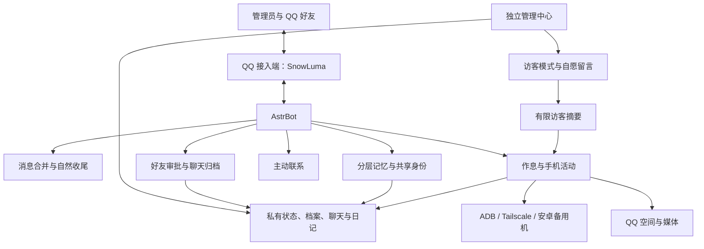

# 小鲸鱼 · 岚 🐋

基于 **AstrBot + QQ + 安卓备用机** 的 AI 陪伴系统：在聊天中积累有依据的记忆，在授权范围内浏览、阅读、收藏与参与社交，通过独立网页管理中心查看状态、聊天、档案和日记。

“小鲸鱼”是最初的称呼，“岚”是聊天过程中形成的名字。项目希望让身份、表达习惯和经历逐渐连贯，同时让执行结果、记忆来源与权限范围能够被检查。

**当前状态：** 已有云端运行实例，本仓库整理截至 **2026-10-25** 的脱敏源码与测试，包含记忆 v1.5、双日记、活动回执及新版网站。尚未完成空白环境的一键部署；实际登录态、私人记录、模型密钥和手机配对资料均不提供。

## 阅读入口

| 内容 | 文档 |
| --- | --- |
| 新对话／维护接手入口 | [项目交接](docs/HANDOFF.md) |
| 跨对话记忆与上下文预算 | [记忆与预算](docs/MEMORY.md) |
| 长文本、分页与完整备份恢复 | [记忆 v1.4](docs/MEMORY_COMPLETENESS.md) |
| 按需分层与分类目录检索 | [记忆 v1.5](docs/MEMORY_LAYERS.md) |
| 系统组成与数据流 | [系统架构](docs/ARCHITECTURE.md) |
| 模块实现、文件与数据索引 | [模块说明](docs/MODULES.md) |
| 安装、配置与目录迁移 | [部署说明](docs/DEPLOYMENT.md) |
| 当前实例确定的行为规则 | [当前行为](docs/CURRENT_BEHAVIOR.md) |
| 审批前如何显示真实 QQ | [好友身份核验](docs/FRIEND_APPROVAL.md) |
| 最近同步了什么 | [更新记录](docs/CHANGELOG.md) |

## 系统组成



QQ 接入端负责收发事件，AstrBot 提供模型和会话，五个插件处理陪伴行为。手机无需一直插在本地电脑上，但云端到手机的私有网络、无线调试与后台连接必须可用。

## 各模块现在能做什么

### 1. 记忆与成长

源码：[astrbot_plugin_companion_memory](astrbot-plugins/astrbot_plugin_companion_memory/)

- **短期对话：** 近期历史按完整用户轮和工具链限制长度，不反复注入整份好友归档。
- **个人核心：** 少量固定或稳定事实常驻上下文，避免每轮完全重新认识对方。
- **长期事实：** SQLite 保存，绑定真实联系人、原话依据和来源编号；支持有证据的更正、版本留存与忘记来源屏蔽。
- **类型与时间：** 稳定知识、计划、短时状态、当前话题、经历、印象和自我档案分开；另管有效期、版本与冲突。过期计划不推断完成，手动固定不被自动覆盖。
- **跨对话：** 姓名、共同性格、已保存记忆和整理游标独立持久化，新窗口按预算恢复，不依靠无限增长的上下文。
- **主动回忆：** 按当前联系人检索旧事、按日期筛选，再按条目编号读原文；无匹配不等于事情没有发生。
- **统一身份：** 名字、别名及允许共享的整体成长进入公共档案；具体私聊、个人事实与私人经历按联系人隔离。普通好友整理不会直接改写全局人格。

检索使用 FTS5 全文索引、关键词、汉字片段与同义扩展，无命中时可有限改写查询，**没有额外向量模型或向量数据库**。自动注入、工具返回、提取输入和调用次数均有预算；保存不等于保证完全召回，详见[记忆与预算](docs/MEMORY.md)。

### 2. 好友审批、私聊与睡眠收件箱

源码：[astrbot_plugin_companion_friends](astrbot-plugins/astrbot_plugin_companion_friends/)

- 已确认的好友可普通私聊；非好友临时消息不进入聊天模型。
- 申请先持久化，再通知管理员。SnowLuma 只给 UID、数字 QQ 为 0 时，先通过只读资料查询解析 QQ 号和可用昵称。
- **身份查不到时不能同意。** 管理员可用 `/核对好友 编号` 重查，看到具体 QQ 后再用 `/同意好友 编号` 或 `/拒绝好友 编号` 决定。
- 查询与通知不会自动加好友。审批超时标记结果待核对，不自动重复提交。
- 好友聊天按人归档，图片尽力缓存，管理员可在网站查看。好友不能操作手机或读取其他人的私聊。
- 睡眠和休息期间消息进入持久化未读队列，醒来后按联系人合并处理。
- 审批通知不占主动联系次数；睡眠期间仍延后发送。

昵称和验证信息可由对方填写，不是管理员身份凭据；判断申请对象以数字 QQ 为准。

### 3. 消息合并与自然收尾

源码：[astrbot_plugin_companion_batch](astrbot-plugins/astrbot_plugin_companion_batch/)

同一联系人最后一条消息后等待 **15 秒**，从本批第一条起最多等待 **60 秒**，再合并交给回复流程。不同联系人独立计时，管理指令沿用指令处理路径。

“好的、嗯嗯、行”等确认是否需要回复，由上下文判断：事情已结束可以静默；首次“我去上课了”“你玩去吧”等离开告知通常先简短接住一次。判断失败或不确定时照常回复。

60 秒只约束合并等待，不包含模型生成和 QQ 发送时间。

### 4. 主动联系与聊天风格

源码：[astrbot_plugin_companion_active](astrbot-plugins/astrbot_plugin_companion_active/)

根据距离上次互动的时间、允许时段、每日额度和未获回应情况，决定是否主动联系管理员；支持查看状态、暂停与恢复。休息和睡眠时不主动联系，不为填满额度而强行聊天。

普通聊天统一清理不自然的句末句号。表情包来自另行安装的第三方管理器，当前实例概率门槛降至 **25%**，普通回复以文字为主；不代表每四轮必发一次。该插件及个人图库未打包，手机图片工具是另一条发送路径。

### 5. 手机浏览、作息与自主活动

源码：[astrbot_plugin_companion_phone](astrbot-plugins/astrbot_plugin_companion_phone/)

- 经 ADB / Tailscale 提供状态、截图、打开应用、搜索、中文输入、点按、返回与滑动。
- 当前实例授权天气、相册、日历、酷安、QQ、哔哩哔哩、百度贴吧、Neat Reader 和 Via；新部署须核实包名并自行授权。
- 在已有权限内自主决定浏览、阅读、播放、搜索、收藏图片和休息，不要求管理员每次发固定口令。
- 一次可连续滑动 **1—5 下**，结束后观察；未观察的中间页面不能当作已读。点按、输入仍依据当前画面或原生 UI 树定位，画面变化会使旧依据失效。
- 单次自主访问最多 **10 分钟**，每日最多 **10 次**；管理员明确交代的访问不占自主访问次数。观察不限次数，仍受时长与执行检查约束。
- 作息结合精力、兴趣、活动与多日习惯，维护清醒、浏览、休息、睡眠状态，并处理重启恢复和时间校验。

自主活动由调度、持久化状态和模型选择共同实现，仍受应用权限约束，不等于任意手机命令。

### 6. 图片、QQ 空间与评论

手机插件中的 `media.py`、`public_images.py`、`outbound.py`、`publisher.py`、`discussions.py` 等模块负责这些能力。

- 相册可分页、预览和发送，分享范围可选专用相册或全部相册。网上图片检查来源与内容后使用，喜欢的图片可保存到手机。
- 可发送图片、表情图和有趣内容给管理员；主动内容分享每天最多 **3 条**。
- 空间正文与配图可由模型决定，当前实例每日最多 **5 条**，没有原来的两小时间隔。
- 保存原稿、发布回执与回读结果，避免“说发了 A，实际另生成 B”。未确认不当作确定成功，也不自动重发。
- 可读取自己的动态、评论及部分楼中楼，接口不完整时在手机展开；支持定位对象、输入评论、回复及回读。
- 当前评论合计每天最多 **10 次**，至少间隔 **60 秒**；点赞有独立授权和额度。

账号自己回读成功不证明所有人可见。QQ 审核、账号限制和 UI 变化仍会影响结果；真实他人评论回复尚有未完成实机验收的场景。

### 7. 双日记与管理中心

源码：[management-center](management-center/)。日记写入由手机插件的 `books.py` 等模块负责。

| 页面或能力 | 当前功能 |
| --- | --- |
| 连接检查 | 容器、AstrBot、OneBot 与 QQ 登录分别检查；在线不直接等于收发正常 |
| 登录恢复 | 人工恢复入口，SnowLuma 对接后台/远程桌面，保留 NapCat 兼容诊断路径 |
| 手机连接 | ADB连通与角色作息分开展示；管理员可填写已配对设备的连接端口，验证失败保留旧设置 |
| 好友聊天 | 按联系人查看启用归档后的聊天、时间和可用图片 |
| 双日记 | 公开本是愿意给大家看的当日总结，平淡也可写；私密本留独立感受，23:30起整理，睡眠延后，不写有简短原因、失败待重试 |
| 档案与记忆 | 公共身份、分层记忆、有权限的原文依据 |
| 小鲸鱼的余粮 | 官方DeepSeek余额、按余额变化的预设文案；可显式连接官网登录态并确认Key，同步该Key及账户费用，不向访客提供账单或凭据 |
| 公开状态表达 | 清醒时用有限公开资料准备“小声话”和活动倾向，睡眠不调用，不把倾向当执行记录 |
| 管理员认证 | 自设密码、scrypt 加盐哈希与会话校验；启动和公网代理凭据独立处理 |
| 访客模式 | 公开状态、档案与日记；不能读取聊天、私人记忆和私密日记 |
| 最近来访 | 同一 IP 的私有加盐摘要在 30 分钟内合并一次网站访问，不追踪具体栏目 |
| 自愿留言 | 自填昵称和留言，只给管理员与小鲸鱼读取，不是公开留言墙 |

昵称未经身份验证，同一 IP 不等于同一个人。本地隧道无法确定真实来源时回退匿名浏览器标识。

活动时间线同时读取有限动作回执，只存类别、时间与次数，不存页面正文或输入。没有回执的聊天自述不补造为完成活动。官网账单同步依赖外部接口与登录态，过期需重新连接，未知金额不当作零。公网后台跳转需额外配置可信反向代理和管理员鉴权。

## 仓库目录

```text
whale-companion/
├── astrbot-plugins/           # 五个插件，内部包名不变
├── management-center/        # 后端、网页、systemd 示例与网站测试
│   ├── web/
│   └── systemd/
├── tests/                    # 插件隔离测试
├── tools/                    # 测试入口与白名单脱敏导出工具
└── docs/                     # 架构、模块、部署、行为与更新记录
```

`plugins/` 更名为 `astrbot-plugins/`，`qq-recovery/` 更名为 `management-center/`。本次整理不要求已运行服务器改目录。新部署的 systemd 示例使用新目录，`QQ_RECOVERY_*` 环境变量、服务名和私有数据目录保留兼容命名。

## 如何复现

需要 Linux/Docker、AstrBot 4.29.x、QQ 接入端和模型服务；手机另需安卓、ADB 和 Tailscale。原实例为 2 核 2 GB、50 GB，仅作资源规模参考。

1. 配置接入端与 AstrBot，先验证正常收发。
2. 将五个 `astrbot-plugins/astrbot_plugin_companion_*` 目录装入 AstrBot 的 `data/plugins/`。
3. 配置管理员、机器人、平台 ID、provider 与角色卡，同时检查尚未配置化的源码常量。
4. 逐项设置手机、截图识别、社交权限和配额；敏感能力的 schema 默认值通常为关闭。
5. 部署管理中心，从本地隧道初始化并设置密码；公网另配受信任的 HTTPS 代理。
6. 按 [部署说明](docs/DEPLOYMENT.md) 验证睡眠、隔离、审批、手机与发布回读。

`100000001` / `100000002` 和 `203.0.113.10` / `100.64.0.10` 都是示例值。仓库不能直接连接现有小鲸鱼实例。

## 验证与开发

在具备 AstrBot 及插件依赖的 Python 环境中运行：

```bash
python tools/run_tests.py
node --check management-center/web/app.js
```

测试入口将插件和网站放到独立解释器，避免同名测试冲突。临时目录、模拟事件和回执验证不能替代所有真实账号、手机及页面验收，最新结果见 [更新记录](docs/CHANGELOG.md)。

## 数据、授权与限制

- 白名单公开源码、测试和说明，不包含密码、API 密钥、SSH 私钥、Cookie、配对密钥、实际私聊、日记、相册和运行数据库。
- 角色插画、个人表情图库未附带；复现时自行提供有权使用的素材，第三方说明随相关代码保留。
- QQ 接入端、AstrBot、表情包插件单独安装并遵守各自许可。本项目不是腾讯官方产品，也不能保证消除账号风控。
- 部分模块依赖 AstrBot 内部接口，升级前应验证兼容。安卓安全键盘、受保护窗口和后台网络可能影响截图与连接。
- 目前未为全部自有代码指定统一开源许可证，第三方许可继续适用；公开展示不等于所有代码和素材都可任意再分发。
- “成长”“睡眠”“兴趣”描述实现机制与表现，不代表人的主观体验，也不保证永久记住所有事情。
