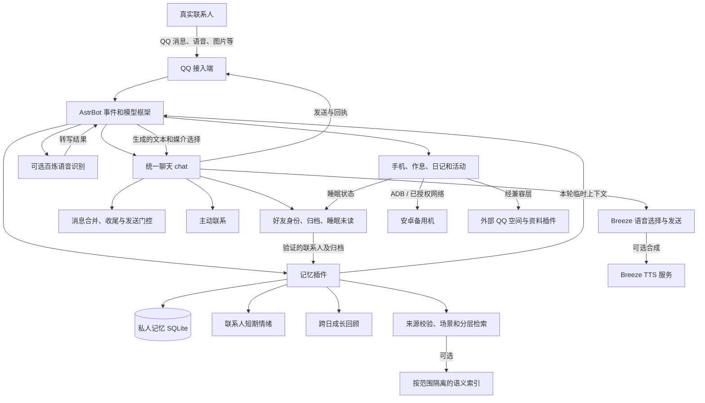

# 模块实现与协作详解

本文解读公开仓库 2026-11-04 的脱敏源码：统一聊天 v1.5.0、记忆 v1.12.0、手机 v1.14.1。这里解释程序如何设计，不代表当前线上配置或后续版本；具体运行情况取决于 AstrBot、接入端、启用的插件、权限、模型服务及其配置。管理中心在仓库里是较早的公开快照，不作为当前管理中心的实现说明。

## 1. 全局图：谁负责什么

图表示主要依赖，并不表示每条消息必然经过每个节点，也不保证事件严格按图的顺序串行执行。AstrBot 通过事件钩子调度插件；部分后台整理、主动联系和手机活动独立运行。登录态、历史、密钥、配额和状态不在这张图或公开仓库中。

| 部分 | 主要职责 | 入口 |
| --- | --- | --- |
| 统一聊天 | 将好友、批处理、主动联系、语音作为内部组件协调，处理事件、模型请求和发送前检查 | [chat/main.py](../astrbot-plugins/astrbot_plugin_companion_chat/main.py) |
| 记忆 | 保存观察与条目，管理来源、生命周期、检索、上下文及相关后台整理 | [memory/main.py](../astrbot-plugins/astrbot_plugin_companion_memory/main.py) |
| 情绪与成长 | 情绪是记忆插件中的联系人状态；成长是需要跨日证据的后台回顾 | [affect.py](../astrbot-plugins/astrbot_plugin_companion_memory/affect.py)、[growth.py](../astrbot-plugins/astrbot_plugin_companion_memory/growth.py) |
| 语音 | 根据上下文选择文字或语音，调用外部合成服务并跟踪发送；另提供可选语音识别适配器 | [chat/breeze/](../astrbot-plugins/astrbot_plugin_companion_chat/breeze/)、[asr/main.py](../astrbot-plugins/astrbot_plugin_companion_asr/main.py) |
| 手机与作息 | 状态机、设备操作、自主活动、双日记和外部社交插件的权限适配 | [phone/main.py](../astrbot-plugins/astrbot_plugin_companion_phone/main.py) |

仓库还保留旧的独立 `active`、`batch`、`friends`、`breeze` 插件。统一聊天包含相应内部组件；启用统一版本前应处理旧插件，避免两个调度器重复工作。`companion_bailian_sing` 是隔离试听实验，不等于当前聊天具备唱歌能力。

## 2. 一次私聊如何经过这些模块

1. **事件进入和身份检查。** QQ 接入端将事件交给 AstrBot。统一聊天的好友组件区分管理员、已验证好友和其他来源；工具可见性与真实发送者绑定。引用、转发等材料与发送者本人说的话在材料处理时区分，不能因为某人转发了一段文字，就把内容全部当作其个人事实。
2. **睡眠与未读。** 若处于睡眠或休息，好友组件将适用的未读事件持久化。醒后按真实发送者分组、恢复处理；运行中若再次进入休息，发送前仍需重新检查。数据库和去重状态由 [sleep_inbox.py](../astrbot-plugins/astrbot_plugin_companion_chat/friends/sleep_inbox.py) 管理。
3. **合并与对话节奏。** `batch` 按联系人合并一段时间内连续发送的消息，限制最长等待，并通过上下文判断是否需要自然收尾；具体时长取配置而非所有部署共享的固定事实。一次合并不意味着不同联系人被合并为同一对象。
4. **记录与准备上下文。** 对适用事件，记忆插件记录来源和消息标识；为当前联系人生成预算内的个人记忆上下文。好友归档可按游标增量导入；非文字附件不会被凭空当作已理解的文字保存。
5. **情绪、能力和工具注入。** 记忆插件在条件满足时准备当前联系人的短期表达状态；聊天组件加入任务真实性约束和可用语音能力提示，并按身份限制工具。它们通过本轮请求携带材料，不等于改写原始会话或持久角色卡。
6. **模型生成和按需回忆。** 模型可以基于可见上下文回复，也可以在获准时调用回忆工具。工具限定当前联系人、返回大小及调用次数；结果是可核验依据，不是对外行动回执。
7. **选择媒介并发送。** 模型或明确的文字／语音偏好决定路线。适合的文本可以交给 Breeze 合成；系统在准备和发送过程中再次检查权限、作息和结果，跟踪接入端回执。失败和不确定情况按下文的回退规则处理。
8. **反馈与后续整理。** 发送后的钩子及归档记录可为记忆整理、检索反馈、后续对话提供依据。后台整理与跨日成长是独立的、有条件的流程，不能把一次模型输出直接当成已验证的永久性格。

相关入口：[chat/main.py](../astrbot-plugins/astrbot_plugin_companion_chat/main.py)、[batch/main.py](../astrbot-plugins/astrbot_plugin_companion_chat/batch/main.py)、[memory/main.py](../astrbot-plugins/astrbot_plugin_companion_memory/main.py)。事件优先级、异步任务以及外部插件都可能影响实际过程，以上是职责链而不是逐行执行跟踪。

## 3. 记忆：从原话到可核验的上下文

### 3.1 保存什么

[MemoryStore](../astrbot-plugins/astrbot_plugin_companion_memory/memory.py) 使用 SQLite。主要概念是：

| 数据 | 用途 |
| --- | --- |
| `observations` | 按联系人保存的用户或助手观察，带来源、时间和去重标识；导入时未知的原始时间不会被虚构 |
| `entries` | 从依据整理出来的事实、经历、计划等条目，保存类型、主题、证据编号、时间、有效期及固定状态 |
| `entry_revisions` 和生命周期记录 | 在更正、冲突和失效时保留历史或状态，而不是简单地把旧文字当成永远正确 |
| `suppressed_sources`、`tombstones` | 支持停止召回及防止被抑制内容无条件重新提取；不等于抹除所有原始聊天和独立备份 |
| `meta`、游标、使用和质量记录 | 控制增量整理、预算、状态及有限审计；它们不等于模型理解或真实行为的证明 |
| 场景、主题、工作交接侧表 | 为已有来源建立可检索视图和导航，并非授权复制到其他人的资料库 |

管理员与已验证好友并不共用一个私人画像。好友资料经验证和归档路径处理，联系人检索限定当前真实发送者；公开资料和获准群记忆使用各自独立的范围与检查。来源自述、助手说过的话、历史计划和真实执行结果是不同类型的证据。

### 3.2 整理、修正与遗忘

后台在可运行且有预算时，按游标选取有限观察，让模型提出结构化候选；程序再检查候选的原文依据、联系人、格式及状态。固定条目不会被自动覆盖。对于事实，[decisions.py](../astrbot-plugins/astrbot_plugin_companion_memory/decisions.py) 处理新增、跳过、更正、合并及拒绝；合并受到原文、正向重述、明确补充和证据数量等约束，并非允许模型自由拼写多条事实。

[lifecycle.py](../astrbot-plugins/astrbot_plugin_companion_memory/lifecycle.py) 维护有效性、来源签名、冲突与遗忘状态。计划到期或缺乏后续证据，不会自动变成已经完成。当前联系人明确要求忘记具体条目时，`companion_memory_forget` 还会检查本轮本人原话和目标；成功语义是停止相关召回，**不承诺删除原始聊天、所有副本或独立备份**。

### 3.3 分层检索与场景

默认回忆由 [retrieval.py](../astrbot-plugins/astrbot_plugin_companion_memory/retrieval.py) 协调：

1. 根据请求类别和措辞选择入口。明确查原话时优先原始对话；需要来龙去脉时可先查场景或主题目录。
2. 一般问题先查结构化记忆卡，匹配不足再查原话归档。先确定联系人、类别、时间、有效性、遗忘及排除范围，再返回候选。
3. 全文检索使用 SQLite FTS 和中文词片段等线索；结果弱时，在配置启用且可用的情况下尝试语义候选。关键词明显命中时不必每次请求向量服务。
4. 同一层同时有文本与语义候选时，[fusion.py](../astrbot-plugins/astrbot_plugin_companion_memory/fusion.py) 在允许集合上使用倒数排名融合：`score(id) = Σ 1 / (60 + rank)`。这是排序规则，不是概率或可信度；语义命中仍须回到来源核验。
5. 仍不足时可有限改写查询，得到目录后通过条目编号分页读取原文。无匹配只能说明这次没有找到，不能证明事情从未发生。

[scenes.py](../astrbot-plugins/astrbot_plugin_companion_memory/scenes.py) 把属于同一联系人的有效事实、限制、待确认计划、历史变化和有限时间线组织为场景卡。模型可提出关联，程序核对关联来源与主题；它不接受模型自由编写新的场景事实。成员来源、版本、遗忘或有效性变化时，读取前重新校验；已过期的场景不应继续作为有效依据。

主要工具包括 `companion_memory_recall`、`companion_memory_read` 和 `companion_memory_forget`。分类如 `facts`、`plans`、`events`、`scenes`、`topics`、`working`、`conversation` 只是检索入口，不能扩大联系人权限。操作经验与质量统计有额外范围约束，历史经验也不能证明本轮已经操作。

### 3.4 预算、语义索引与备份

[budget.py](../astrbot-plugins/astrbot_plugin_companion_memory/budget.py) 在本版源码中给私人自动上下文设置 2,600 UTF-8 字节上限，并为各层设置子预算；回忆工具单次最多 1,800 字节、同轮累计 4,200 字节，调用次数由入口限制。历史裁剪尽量保留完整用户轮及其工具链。字节预算不是模型计费 token，也不代表整个请求总长。

可选语义索引由 [semantic.py](../astrbot-plugins/astrbot_plugin_companion_memory/semantic.py)、[vault.py](../astrbot-plugins/astrbot_plugin_companion_memory/vault.py) 及访问边界协作：将有资格的资料组织成按范围区分的可读投影与索引，以既有来源作为最终核验依据。需要额外的嵌入服务、配置与独立预算；关闭或服务不可用时，不能宣称语义检索生效。索引或笔记投影不是另一套无条件可信的事实源。

[portable.py](../astrbot-plugins/astrbot_plugin_companion_memory/portable.py) 使用 SQLite 备份接口等方式构建并校验隔离恢复包；恢复目标必须是不存在的新目录。不要把旧数据库或整包恢复到正在运行的实例上覆盖新聊天、日记、游标和计数。备份同样包含私人资料，应单独保护。

## 4. 情绪和成长如何影响回复

### 4.1 短期状态

情绪不是单独注册的聊天机器人，而是记忆插件中的 [Affect](../astrbot-plugins/astrbot_plugin_companion_memory/affect.py)。状态键按真实联系人区分，包含连续主心情、最多三个保留的余绪、时间与去重信息。有效好友或管理员的私聊在适用时可触发一次有独立额度的模型判断；睡眠、配置关闭、无可用模型、消息重复或预算耗尽时不会无限重试。

模型候选包含变化方向 `delta`、强度 `intensity`、情绪增减及当前消息中的连续原话。程序只接受有限枚举和有效原文；不合规则保持先前状态。主心情被限制在 -3 到 3 之间，并随时间衰减；不同余绪还有各自的生命周期、强度和衰减。修复可以缓和余绪，但一次互动不会让负向心情直接越过中性跳到正向。普通纠错、离线或结束聊天不会被默认解释为攻击或冷落。

这是程序状态和模型判断，**不是测量人类感受或证明主观体验**。状态摘要以临时 `<companion_expressive_state>` 片段进入合适的模型请求，提示模型结合眼前语境自然表达；不会直接改变用户身份、工具权限或隐私边界。模型是否真正遵循提示、表达是否合适，仍需观察和评测。

### 4.2 跨日成长

短期心情不会直接写成永久性格。[growth.py](../astrbot-plugins/astrbot_plugin_companion_memory/growth.py) 在具备条件时，针对有限的过去 14 天样本做周期性回顾；候选需要 2–4 条可核对的用户原文、覆盖至少两个日期，并包含上次游标之后的新依据。校验不通过、材料不足、内容私人或没有稳定变化时可以不更新。

通过检查的结果还经过共同性格同步和隐私边界。代码中的性格轴是受限的程序表示，只有在已有成长候选被接受、轴及变化值有效后才可能更新；不将单句玩笑、模型自述或情绪余波直接当成跨会话事实。实际是否形成稳定习惯不能仅凭这套机制断言。

### 4.3 情绪怎样进入语音

语音组件不会读取情绪数据库后机械地把某个数值映射成音量。情绪摘要与对话内容共同作为模型本轮语境；模型若选择语音，可以生成本句的说话正文和独立表演方向。方向需要与话语意图一致并经过长度、敏感内容及声线变更检查；短期状态是表达线索，不保证合成声音一定体现预期情绪。

## 5. 语音：输入识别、输出选择与发送证据

### 5.1 收到语音

[百炼识别适配器](../astrbot-plugins/astrbot_plugin_companion_asr/main.py) 注册 AstrBot 的语音转文字 provider。启用并配置后，它通过 AstrBot 的媒体解析器将音频转换为 WAV，检查大小、时长和作息，再调用外部识别服务并解析转写文本。密钥来自运行配置，不在仓库中。识别失败、服务不可用或休息时不能当作已经理解音频；语音、图片和视频的其他多模态能力依赖各自的外部组件。

### 5.2 选择文字还是语音

[breeze/main.py](../astrbot-plugins/astrbot_plugin_companion_chat/breeze/main.py) 首先检查插件开关、平台、真实私聊对象、好友验证和清醒状态。适用时，它为本轮模型请求加入语音能力和媒介选择规则；联系人的明确文字／语音偏好优先，同一批消息中以最后明确方向为准。模型也可结合当前上下文选择，不为凑次数强制发语音。

[performance.py](../astrbot-plugins/astrbot_plugin_companion_chat/breeze/performance.py) 解析本轮选择：文字使用 `[[text]]`，语音可用 `[[voice]]` 加包含 `text` 和 `instructions` 的结构。只有 `text` 是要说出的内容；`instructions` 是可选的当前句表演方向，不应进入对话正文。解析异常或选择缺失时以安全的文字路径处理，不能把内部控制格式当作用户应看到的回复。

### 5.3 合成、退回文字和回执

[client.py](../astrbot-plugins/astrbot_plugin_companion_chat/breeze/client.py) 检查文本是否适合朗读、读取私有凭据、记录每日调用尝试，然后请求外部 Breeze TTS 并检查返回的音频格式与大小。合成调用会把本句文本及通过校验的表演方向发送给外部服务；配额、可用性和隐私需依赖部署者自身配置。示例音色 ID 不是可直接使用的真实配置。

合成成功后，插件准备 QQ 语音消息，再次核对权限和清醒状态。它与好友组件的发送跟踪合作：

- 合成失败、文本不适合、忙碌或不满足条件时，保留文字路径。
- 接入端明确拒绝语音时，在仍有权限且清醒的前提下，可尝试发送同一文字；文字也需回执。
- 如果发送结果未知，不把未知当作明确拒绝反复重发，也不能说已送达。
- 准备音频、请求发送和接入端确认是不同阶段；一次服务返回音频不证明对方已听到。

语音识别与语音合成是两条不同链路：前者把输入音频转为可供处理的文字，后者把选定回复转换为可发送音频。两者都需要实际服务和权限，不能仅凭目录存在认定运行正常。

## 6. 手机、自主活动与其他模块的关系

[rhythm.py](../astrbot-plugins/astrbot_plugin_companion_phone/rhythm.py) 保存清醒、休息、睡眠和浏览等状态，维护时间、精力与活动信息；它自身不是设备 API。手机插件与聊天的好友组件共享适用的休息判断，因而聊天、记忆整理和需要角色清醒的操作会受到门控。网络连接维护和角色是否休息是不同问题；明确委托的手机操作同样要经过相应门控和授权。

手机操作通过授权的设备通道、应用范围、操作检查和配额执行。自主浏览、公开阅读、经验和日记有各自的状态与边界；模型提出想做某事不等于实际已经打开网页、看过内容、保存文件或发送消息。需要核对相应工具回执与后续结果。

当前公开手机源码通过 [social_compat.py](../astrbot-plugins/astrbot_plugin_companion_phone/social_compat.py)、[social_policy.py](../astrbot-plugins/astrbot_plugin_companion_phone/social_policy.py) 和 [social_autonomy.py](../astrbot-plugins/astrbot_plugin_companion_phone/social_autonomy.py) 衔接外部 QQ 空间及资料插件。后台按类别安排考虑时机，检查睡眠／暂停，并只向该活动提供相应工具；考虑一次不代表必然发布或修改资料。第三方插件及 QQ 平台的接口、审核、实际权限和回执仍会影响结果。仓库中旧空间执行器与旧测试属于历史兼容材料，不代表现行社交流程。

公开与私密日记有不同用途和读取范围；私人聊天、记忆、私密日记不能因管理员可查看就自动用于公开动态或向其他联系人复述。具体公开性仍须依赖来源校验和实际配置，而不是只依赖提示词。

## 7. 复现、验证和已知边界

- 本项目依赖 AstrBot 事件、工具和 provider 接口，可能受版本变化影响；先在隔离环境验证插件加载和钩子顺序。
- 统一聊天须带齐内部子目录，并避免与旧版独立调度插件重复启用。QQ 接入端、嵌入、语音、第三方社交插件及安卓设备均需自行准备。
- `tests/` 中有来源隔离、场景、情绪、语音路由、统一聊天和手机行为等测试；有些依赖 AstrBot、Linux 或历史组件。模拟模型和模拟接入端通过，不等于真实 QQ、音频、手机或对外可见性通过。
- 可从 `test_memory_scenes.py`、`test_memory_control.py`、`test_affect_state.py`、`test_chat_unified.py`、`test_breeze_bridge.py`、`test_social_autonomy.py` 等入手，结合实际依赖分别运行；测试结论以当前环境结果为准。
- 私人原话、联系人 ID、数据库、音频素材、模型密钥、令牌和实例配置不随仓库发布。历史备份应独立保管；不要为了复现而覆盖现有数据。
- 更早的 [记忆说明](MEMORY.md)、[v1.5 说明](MEMORY_LAYERS.md) 和其他部署文档描述的是当时的实现。特别是旧文档中“没有向量服务”的说法适用于其历史版本；本版存在需单独启用的语义检索路径。

维护时建议先核对具体源码和测试，再修改对应模块与文档；不要把本页描述当作对线上实例、真实聊天质量、模型行为或实际服务状态的持续监控。
